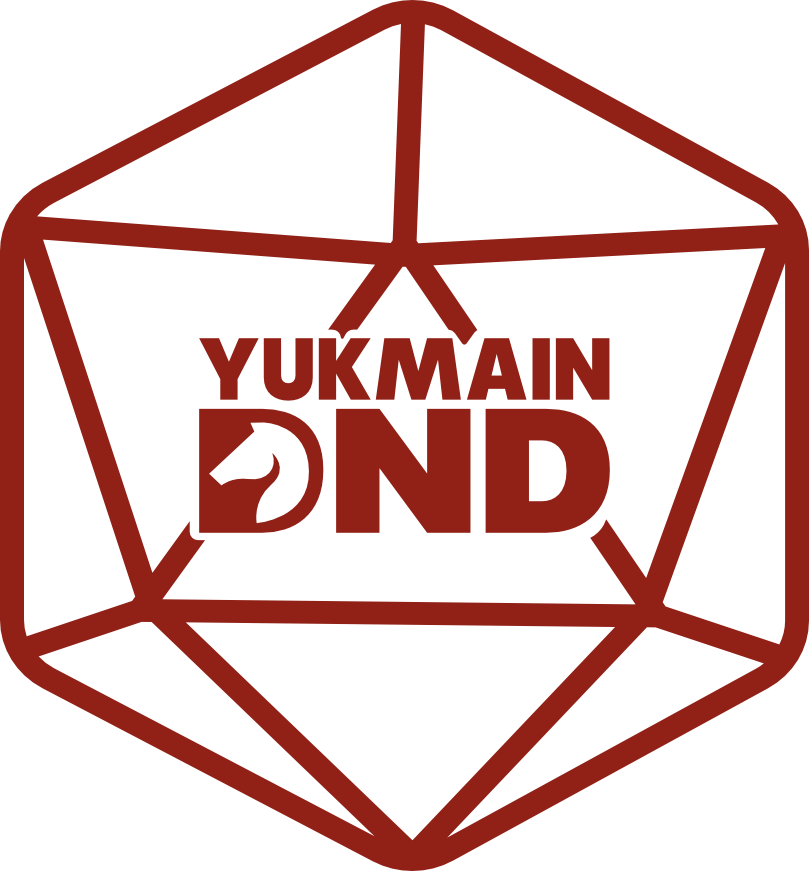

<p align="center">
  <a href="https://yukmaindnd.vercel.app" target="blank"></a>
</p>

# yuk-main-dnd-api

NestJS REST API for the Yuk Main DnD community.

## Prerequisites

- Node.js v24.9.0 (see `.nvmrc`)
- Docker + Docker Compose
- npm

## Getting Started

### 1. Clone & install

```bash
git clone https://github.com/yusril-adr/yuk-main-dnd-api.git && cd yuk-main-dnd-api
npm install
```

### 2. Environment

```bash
cp .env.example .env
```

Fill these in before you start Postgres or the app:

- `MAIN_DB_*` must match `docker-compose.yaml`. Compose reads the same variables and falls back to user `root123`, password `requestor`, database `requestor`, and port `5432`. `.env.example` uses placeholders, so set `MAIN_DB_USERNAME`, `MAIN_DB_PASSWORD`, and `MAIN_DB_DATABASE` to those values (or to whatever you pass into Compose). Keep `MAIN_DB_HOST=127.0.0.1`.
- `ACCESS_TOKEN_KEY` signs JWTs.
- `USER_DUMMY_PASSWORD` is the password assigned to every seeded user.
- Supabase storage keys are required only for upload and download.

### 3. Start PostgreSQL

```bash
docker compose up -d
```

This starts PostgreSQL 17.

### 4. Run migrations

```bash
npm run migration:run
```

### 5. Run seeders

```bash
npm run seed
```

Seeders load permissions, the `guild-master` and `player` roles from `seeders/main/datas/role.json`, and the users in `seeders/main/datas/user.json`. Every seeded user gets `USER_DUMMY_PASSWORD`.

### 6. Start the app

```bash
npm run start:dev
```

The app listens on `APP_PORT` (default `8000`). The global prefix is `api` with URI versioning, so module routes live under `/api/v1`.

## Available Scripts

| Script                       | Description                              |
| ---------------------------- | ---------------------------------------- |
| `npm run start:dev`          | Dev server with hot reload               |
| `npm run start`              | Start once                               |
| `npm run start:debug`        | Dev server with the inspector            |
| `npm run start:prod`         | Run `node dist/main` after a build       |
| `npm run build`              | Compile with `nest build`                |
| `npm run lint`               | ESLint with fix                          |
| `npm run test`               | Jest                                     |
| `npm run migration:generate` | Generate a migration from entity changes |
| `npm run migration:create`   | Create an empty migration                |
| `npm run migration:run`      | Run pending migrations                   |
| `npm run migration:revert`   | Revert the last migration                |
| `npm run seed`               | Run database seeders                     |

`migration:generate`, `migration:run`, and `migration:revert` use `src/infrastructure/databases/main.ds.ts`.

## File storage

Configure Supabase Storage in `.env`:

```env
STORAGE_DRIVER=supabase

FILE_USER_AVATAR_BUCKET=
FILE_USER_AVATAR_PATH_PREFIX=users
FILE_USER_AVATAR_MAX_FILE_SIZE_BYTES=3145728

FILE_STORY_BANNER_BUCKET=
FILE_STORY_BANNER_PATH_PREFIX=stories
FILE_STORY_BANNER_MAX_FILE_SIZE_BYTES=5242880

FILE_OTHER_BUCKET=
FILE_OTHER_PATH_PREFIX=others
FILE_OTHER_MAX_FILE_SIZE_BYTES=10485760

SUPABASE_URL=
SUPABASE_SERVICE_ROLE_KEY=
SUPABASE_SIGNED_URL_EXPIRES_IN=900
```

Upload purpose `1` is a user avatar and purpose `2` is a story banner. Both stay temporary (`status` `1`) until a user or story write promotes the file to active (`status` `2`). Purpose `3` (other) is stored active immediately.

## Project layout

- `src/modules` — App, Auth, File, Iam, Story, Global
- `src/entities/main` — TypeORM entities
- `migrations/main` — schema migrations
- `seeders/main` — permissions, roles, and users
- `docs/db.dbml` — database diagram

## Tech Stack

NestJS 11 · CQRS · TypeORM · PostgreSQL 17 · JWT · bcrypt · class-validator · dayjs · typeorm-extension · Supabase Storage · Sentry
